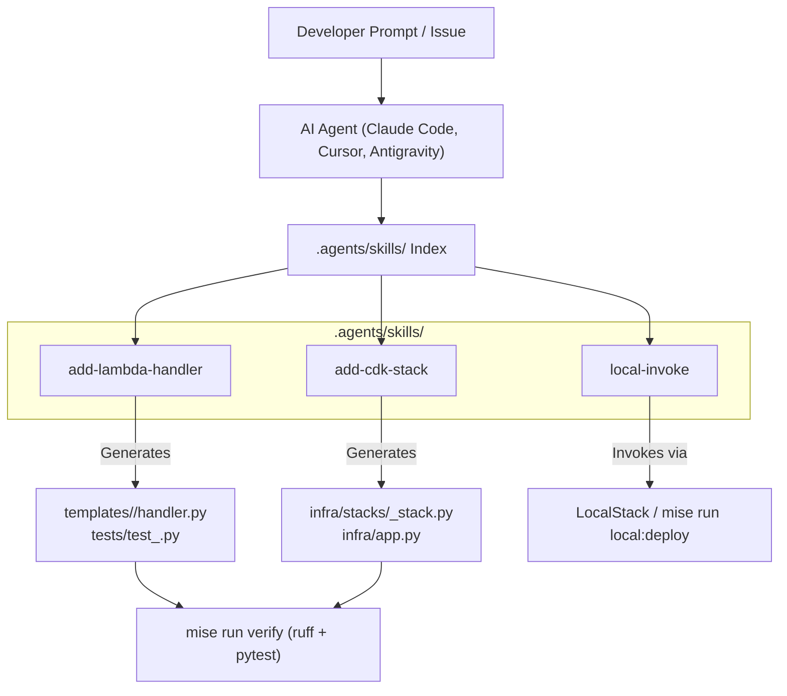

# Design: Agent Skills for cur8d Lambda

## Architecture Overview



## Directory Structure

Skills will be placed in `.agents/skills/` to ensure immediate compatibility with `skills.sh`, Claude Code, Cursor, and other agent platforms:

```text
aws-lambda-templates/
├── .agents/
│   └── skills/
│       ├── add-lambda-handler/
│       │   └── SKILL.md
│       ├── add-cdk-stack/
│       │   └── SKILL.md
│       └── local-invoke/
│           ├── SKILL.md
│           └── templates/
│               └── sample-event.json
├── infra/
├── templates/
└── mise.toml
```

## Skill Definitions

### 1. `add-lambda-handler`
- **Frontmatter**:
  ```yaml
  ---
  name: add-lambda-handler
  description: Scaffolds a new AWS Lambda function handler adhering to cur8d standards with Powertools (Logger, Tracer, Metrics), Pydantic payload models, and unit tests. Use whenever asked to create, add, or implement a Lambda handler.
  category: coding
  tags: [aws, lambda, python, powertools, cur8d]
  ---
  ```
- **Rules**:
  - Requires `@logger.inject_lambda_context`, `@tracer.capture_lambda_handler`, `@metrics.log_metrics`.
  - Requires Pydantic models in `models.py`.
  - Requires pytest unit test in `tests/` with mocked AWS context.

### 2. `add-cdk-stack`
- **Frontmatter**:
  ```yaml
  ---
  name: add-cdk-stack
  description: Creates a new AWS CDK infrastructure stack under infra/stacks/ wired to Lambda handlers, permissions, and event triggers. Use whenever asked to add AWS infrastructure, CDK stacks, or triggers for a Lambda.
  category: coding
  tags: [aws, cdk, infra, lambda, cur8d]
  ---
  ```
- **Rules**:
  - Inherits from `aws_cdk.Stack`.
  - Configures memory, timeout, environment variables, log retention.
  - Registers the stack in `infra/app.py`.

### 3. `local-invoke`
- **Frontmatter**:
  ```yaml
  ---
  name: local-invoke
  description: Generates synthetic event payloads and tests Lambda execution locally using LocalStack. Use whenever asked to test, invoke, or debug a Lambda function locally.
  category: coding
  tags: [aws, lambda, localstack, testing, cur8d]
  ---
  ```
- **Rules**:
  - Leverages `mise run local:up` and `mise run local:deploy <stack>`.
  - Formats payloads in accordance with AWS service event specs (APIGW proxy, SQS message, S3 event).
