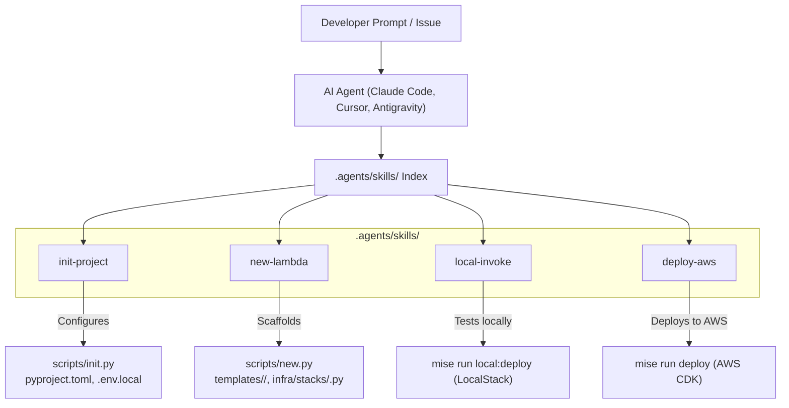

# Design: Agent Skills for cur8d Lambda

## Architecture Overview



## Directory Structure

```text
aws-lambda-templates/
├── .agents/
│   └── skills/
│       ├── init-project/
│       │   └── SKILL.md
│       ├── new-lambda/
│       │   └── SKILL.md
│       ├── local-invoke/
│       │   └── SKILL.md
│       └── deploy-aws/
│           └── SKILL.md
├── infra/
├── templates/
├── scripts/
└── mise.toml
```

## Skill Definitions

### 1. `init-project`
- **Frontmatter**:
  ```yaml
  ---
  name: init-project
  description: Initializes and customizes a new AWS Lambda service repository from the cur8d/lambda template. Use whenever asked to initialize, bootstrap, or fork this template into a new project.
  category: system
  tags: [scaffolding, template, init, cur8d]
  ---
  ```
- **Rules**:
  - Prompts for or accepts `--project-name`, `--description`, `--author`.
  - Executes `uv run python scripts/init.py` or updates `pyproject.toml` and documentation.
  - Copies `.env.local.example` to `.env.local`.

### 2. `new-lambda`
- **Frontmatter**:
  ```yaml
  ---
  name: new-lambda
  description: Scaffolds a new event-driven Lambda function with Powertools, Pydantic models, unit tests, and CDK infrastructure stack. Use whenever asked to create, scaffold, or add a new Lambda template or handler.
  category: coding
  tags: [aws, lambda, cdk, python, powertools, cur8d]
  ---
  ```
- **Rules**:
  - Leverages `uv run python scripts/new.py --name <name>`.
  - Configures event trigger (API, SQS, S3, EventBridge, DynamoDB).
  - Enforces Powertools (`Logger`, `Tracer`, `Metrics`).
  - Verifies with `mise run test`.

### 3. `local-invoke`
- **Frontmatter**:
  ```yaml
  ---
  name: local-invoke
  description: Generates synthetic event payloads and tests Lambda execution locally using LocalStack. Use whenever asked to test, invoke, or debug a Lambda function locally.
  category: coding
  tags: [aws, lambda, localstack, testing, cur8d]
  ---
  ```
- **Rules**:
  - Uses `mise run local:up` and `mise run local:deploy <stack>`.
  - Synthesizes event payload matching the trigger schema.

### 4. `deploy-aws`
- **Frontmatter**:
  ```yaml
  ---
  name: deploy-aws
  description: Synthesizes, diffs, and deploys CDK Lambda stacks to AWS cloud environments using mise and CDK CLI. Use whenever asked to deploy, diff, or inspect cloud deployment for this Lambda service.
  category: coding
  tags: [aws, cdk, deploy, cloud, cur8d]
  ---
  ```
- **Rules**:
  - Validates AWS credentials with `aws sts get-caller-identity`.
  - Requires pre-flight verification `mise run verify`.
  - Previews changes with `mise run diff <stack>`.
  - Executes deployment with `mise run deploy <stack>`.
